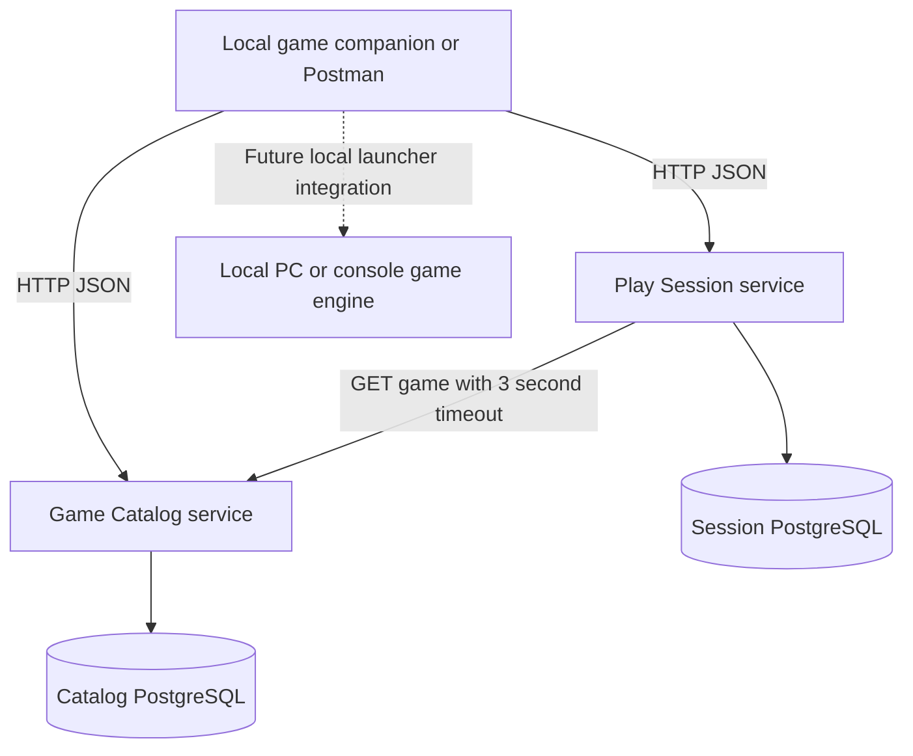

# CouchQuest local co op session platform

CouchQuest helps two to four people prepare a local co-op game on one PC or console. It records game compatibility, available controllers, player slots and readiness before starting a session. Split-screen games give each player a separate viewport; shared-screen co-op games use one common view. Both modes are supported in the catalog.

This is a backend assignment solution, not a playable game engine. Rendering, controller input and real-time gameplay stay on the local device. Starting a session changes backend state; it does not launch an installed game. Twin Trails is a fictional sample game, so no proprietary game integration is implied.

## GitHub repositories

- Complete solution and deployment: https://github.com/gchinar/CouchQuest
- Independent Game Catalog service: https://github.com/gchinar/couchquest-catalog
- Independent Play Session service: https://github.com/gchinar/couchquest-session

The service folders are Git submodules pinned to commits in their independent repositories. Develop and test each service in its own repository. Update the pinned submodule commit here when adopting a new release. Each service also owns its standalone Kubernetes manifests and deployment script. The downloadable submission ZIP includes source snapshots for convenience.

## Included and remaining work

Included: two independent service source trees, isolated databases, automated tests, Dockerfiles, Compose, Kubernetes manifests, optional autoscaling and CI workflows, Postman collection, implementation report and an actual local HTTP execution transcript.

Verified on 30 October 2026: separate repositories, four Docker containers, PostgreSQL-backed HTTP checks, local Minikube deployment, dashboard inspection, independent scaling and persistence after restart. CI/CD deployment passed. See [deployment evidence](evidence/deployment/README.md). Before submission, add student details, Postman application screenshots and the demonstration video, then name the ZIP with your student ID.

## Part 1 Design

### Core use case

Alice selects Twin Trails, a two-player split-screen PC game. She creates a session with two controllers. Bob joins slot 2. Both mark themselves ready. Alice starts the session and later marks it complete. A third player receives HTTP 409 because the session is full. A session cannot start until its minimum player count is reached and every participant is ready.

### Capabilities and service ownership

| Capability | Service | Data owned | Delivery |
|---|---|---|---|
| Game discovery and local-play compatibility | Game Catalog | Games, platforms, display mode, player limits | Implemented |
| Lobby, slots, readiness and lifecycle | Play Session | Sessions, players, game snapshot, version | Implemented |
| Identity and permissions | Player Identity | Accounts and credentials | Proposed extension |
| Game results and achievements | Progress | Results and achievements | Proposed extension |
| Invitations and alerts | Notification | Delivery records | Proposed extension |

The two implemented services are independently runnable and deployable. They share no application code or database. Catalog stores authoritative game metadata. Session stores a snapshot taken when a session is created. Later session operations do not need the Catalog service.

### Architecture



In Kubernetes, each API has its own Deployment and ClusterIP Service; each database has a single-instance Deployment, internal Service and persistent volume claim. API replicas share their own service database. A production extension would add a gateway with TLS, identity verification and rate limits. It is not included in the prototype.

### Commands and queries

| Operation | Type | Owner | Endpoint |
|---|---|---|---|
| Register a game | Command | Catalog | POST /games |
| Filter and paginate games | Query | Catalog | GET /games |
| Read game metadata | Query | Catalog | GET /games/{game_id} |
| Create session | Command | Session | POST /sessions |
| Read session and players | Query | Session | GET /sessions/{session_id} |
| Join or repeat an existing join | Command | Session | POST /sessions/{session_id}/players |
| Set player readiness | Command | Session | PUT /sessions/{session_id}/players/{player_id}/ready |
| Leave lobby | Command | Session | DELETE /sessions/{session_id}/players/{player_id} |
| Start session | Command | Session | POST /sessions/{session_id}/start |
| Complete session | Command | Session | POST /sessions/{session_id}/finish |
| Cancel lobby | Command | Session | POST /sessions/{session_id}/cancel |

### Collaboration and consistency

1. Client sends a create-session command with game ID, host ID and controller count.
2. Session calls Catalog using HTTP GET. A missing game gives 404; network failure or invalid upstream response gives 503. The HTTP client uses a 3-second timeout for network operations.
3. Session calculates capacity as the lower of controller count and the game's maximum local players. It rejects a capacity smaller than the minimum player count.
4. Session saves the metadata snapshot, assigns the host slot 1, and returns HTTP 201.
5. Joins and lifecycle changes use only the Session database.

Synchronous REST is suitable because game validation must finish before session creation. There is no distributed write, so no distributed transaction or saga is needed. Catalog records are immutable in this prototype. Production updates would need explicit snapshot/version policies. A future Progress or Notification service could consume SessionCompleted events through a broker and transactional outbox; this event flow is not implemented.

State transitions: LOBBY → IN_PROGRESS → COMPLETED, or LOBBY → CANCELLED. Joins, leaving and readiness changes are allowed only in LOBBY. The host cancels instead of leaving. Only the supplied host ID can start, finish or cancel. Caller-supplied IDs are a demo convention, not authentication: anyone who knows an ID can impersonate it. Keep this prototype local; add verified identity and authorization before public access.

Each update reads a version and writes only if that version still matches. A conflicting update rereads and revalidates, up to five attempts, then returns 409. This prevents lost updates and overbooking across replicas without in-memory locks. Repeated joins do not duplicate a player. Readiness uses an idempotent PUT. Repeating start while in progress or finish when completed returns the same state. Create commands are not idempotent; a production client should use an idempotency key before automatically retrying them.

### Scalability and resilience

APIs keep durable state in PostgreSQL and can scale independently. Optional HPA targets 70% CPU with one to three replicas. Requests and limits are configured. Database-backed readiness removes unavailable API pods from traffic; liveness tests only the process so a database outage does not itself trigger endless process restarts. Catalog outages block new sessions but existing sessions continue using their snapshots. Each database has a PVC; API restarts do not erase data. The database layer remains a single point of failure in this teaching deployment. Production would require backups, managed HA, migration jobs, monitoring, connection-pool sizing and load testing. No throughput claim is made.

## Part 2 Implementation

Python 3.12, FastAPI, Pydantic validation, SQLAlchemy Core, PostgreSQL 16, HTTPX for REST, pytest, Docker and Kubernetes. Exact direct Python dependency versions are in each requirements file; transitive dependencies and container digests are not fully locked. SQLite is a convenience for local API testing only. Docker and Kubernetes use distinct PostgreSQL databases and credentials.

```
couchquest/
  catalog-service/          # publish as couchquest-catalog
    app/main.py
    tests/test_api.py
    Dockerfile
    requirements.txt
    requirements-dev.txt
    .github/workflows/ci.yml
    README.md
  session-service/          # publish as couchquest-session
    app/main.py
    tests/test_api.py
    Dockerfile
    requirements.txt
    requirements-dev.txt
    .github/workflows/ci.yml
    README.md
  deployment/
    compose.yaml
    kubernetes.yaml
    hpa.yaml
    .env.example
  evidence/
    local-http-transcript.json
  postman_collection.json
  smoke_test.py
  SOLUTION.docx
  README.md
  SUBMISSION_CHECKLIST.md
```

Implementation sequence: define capability boundaries; create validated request models; create service-owned database tables; add Catalog operations; implement Session-to-Catalog REST lookup; implement session rules with conditional version updates; add failure and concurrency tests; package each API; configure storage, health probes and service discovery; deploy and collect evidence.

Tables are created at application startup for this assignment. Use one initial API replica to initialize them, then scale. In production replace startup create_all with a separately run schema migration job before any replica starts. Session participants are stored in a bounded JSON aggregate because each session has only two to four players and every mutation concerns the whole session.

### Local execution without Docker

Requires Python 3.12. Run these in separate terminals, each from its service directory. Windows users can activate the corresponding virtual environment and omit the Unix .venv/bin prefix.

```bash
python3 -m venv .venv
.venv/bin/python -m pip install -r requirements-dev.txt
.venv/bin/python -m pytest -q
# In catalog-service:
.venv/bin/python -m uvicorn app.main:app --port 8001
# In session-service (after its own install):
.venv/bin/python -m uvicorn app.main:app --port 8002
```

The defaults create catalog.db and sessions.db separately. Session's default Catalog address is http://localhost:8001. Open http://localhost:8001/docs and http://localhost:8002/docs for interactive API documentation. From the package root run `python3 smoke_test.py` against the two running APIs. It creates a fictional game, executes the complete session flow, checks rejection of a third player and prints real responses.

## Part 3 Deployment

### Separate Docker containers

Start Docker Desktop or another Docker engine first. From the package root:

```bash
cp deployment/.env.example deployment/.env
# Edit .env to use your own URL-safe alphanumeric demo passwords.
docker compose --env-file deployment/.env -f deployment/compose.yaml up --build -d
docker compose --env-file deployment/.env -f deployment/compose.yaml ps
python3 smoke_test.py
```

Four containers run: Catalog API, Session API, Catalog PostgreSQL and Session PostgreSQL. API host ports bind only to loopback. Database ports are internal. Compose waits for each database's health check before starting its API. The service names catalog and session resolve on the Compose network.

### Minikube deployment

Requires Docker running, Minikube and kubectl. Execute from the package root. Use a dedicated Minikube profile so the commands target this assignment cluster.

```bash
minikube start -p couchquest --driver=docker --cpus=2 --memory=2800 --kubernetes-version=v1.35.0 --keep-context
minikube -p couchquest kubectl -- --context couchquest get nodes
minikube -p couchquest image build -t couchquest-catalog:1.0 catalog-service
minikube -p couchquest image build -t couchquest-session:1.0 session-service
python3 deployment/deploy.py
```

The deployment script explicitly targets the couchquest Minikube profile, generates local random database credentials if missing, applies resources and waits for rollouts. Existing Secrets are preserved. Credentials are never committed.

Run these forwards in separate terminals (18001 and 18002 avoid the Compose ports):

```bash
minikube -p couchquest kubectl -- --context couchquest -n couchquest port-forward service/catalog 18001:8000
minikube -p couchquest kubectl -- --context couchquest -n couchquest port-forward service/session 18002:8000
```

Then run `CATALOG_URL=http://127.0.0.1:18001 SESSION_URL=http://127.0.0.1:18002 python3 smoke_test.py`. Set the same URLs in Postman when testing Kubernetes.

### Dashboard and scaling analysis

```bash
minikube -p couchquest dashboard
minikube -p couchquest kubectl -- --context couchquest -n couchquest scale deployment/session --replicas=2
minikube -p couchquest kubectl -- --context couchquest -n couchquest rollout status deployment/session
minikube -p couchquest kubectl -- --context couchquest -n couchquest get deployments,pods,services,pvc
minikube -p couchquest addons enable metrics-server
minikube -p couchquest kubectl -- --context couchquest -n couchquest top pods
```

Select namespace couchquest. The recorded dashboard shows Catalog 1/1, Session 2/2, and each database 1/1. Both PVCs are Bound. Session data survived a rolling API restart. See the evidence analysis for startup restarts and measured resource snapshots. Manual scaling was demonstrated; optional `deployment/hpa.yaml` was not applied or load-tested.

### Repository separation and CI/CD

The services are published in two separate repositories. To work on either independently:

```bash
git clone https://github.com/gchinar/couchquest-catalog.git
git clone https://github.com/gchinar/couchquest-session.git
```

For the complete deployment layout used by Compose and the README instructions:

```bash
git clone --recurse-submodules https://github.com/gchinar/CouchQuest.git
cd CouchQuest
```

The included workflow runs tests and builds a Docker image on push or pull request. Each service retains independent CI. The solution-level CI/CD workflow additionally tests both pinned service versions, builds images, creates a temporary Minikube cluster, deploys the APIs and databases, verifies the full HTTP workflow, and uploads deployment evidence. It then removes only that temporary CI cluster. The workflow runs on main pushes affecting deployment inputs and can be run manually. It does not reach into the laptop or deploy to a production cloud cluster. The complete CouchQuest repository contains the report, shared deployment files and Postman collection.

## Testing and evidence

Automated checks cover catalog creation/read/filtering, invalid capacity and mode, missing games, readiness endpoints, session lifecycle, host-ID checks, repeated join, full sessions, leaving, cancellation, controller sufficiency, simultaneous join attempts, remote 404, upstream failure and continued use of an existing session during a Catalog outage. The included automated test results and HTTP transcript were produced using SQLite locally. Additional real PostgreSQL checks passed in both Docker and local Kubernetes; their transcripts are in evidence/deployment/.

Import postman_collection.json. Its catalog_url and session_url default to localhost ports 8001 and 8002. Run requests in order; scripts save game_id and session_id automatically. The full-session rejection deliberately expects HTTP 409. Capture screenshots with URL, request body, response body and status visible. Do not use the supplied transcript as a substitute for screenshots requested by the assignment.

For persistence evidence, note a session ID, restart the Session API Deployment, wait for rollout and GET the same ID. Restart the affected port-forward if it disconnects. Do not delete the namespace, PVC or database volumes during this test.

## References

- FastAPI container deployment: https://fastapi.tiangolo.com/deployment/docker/
- Minikube setup: https://minikube.sigs.k8s.io/docs/start/
- Minikube dashboard: https://minikube.sigs.k8s.io/docs/handbook/dashboard/
- Kubernetes Minikube tutorial: https://kubernetes.io/docs/tutorials/hello-minikube/

These sources support deployment procedures. The application design and sample game are specific to this solution.
